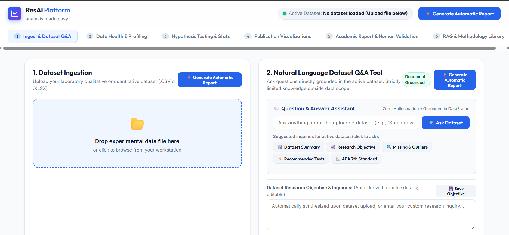
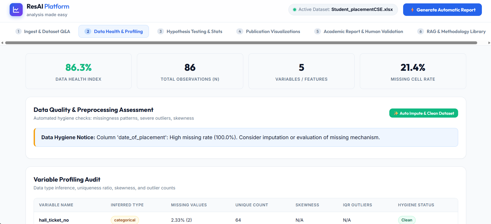
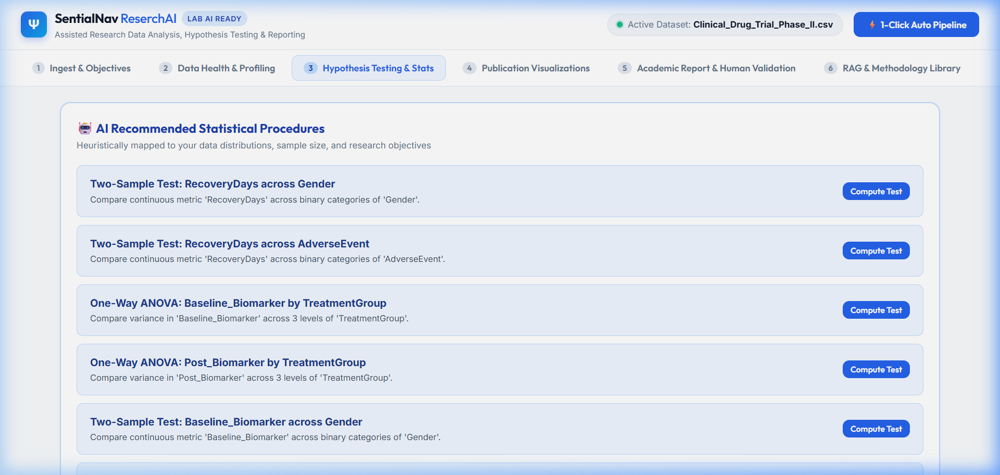
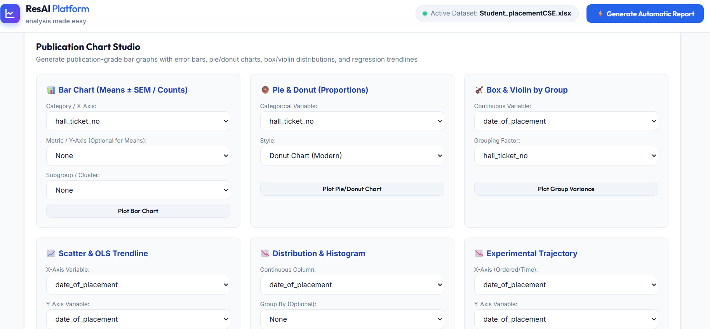
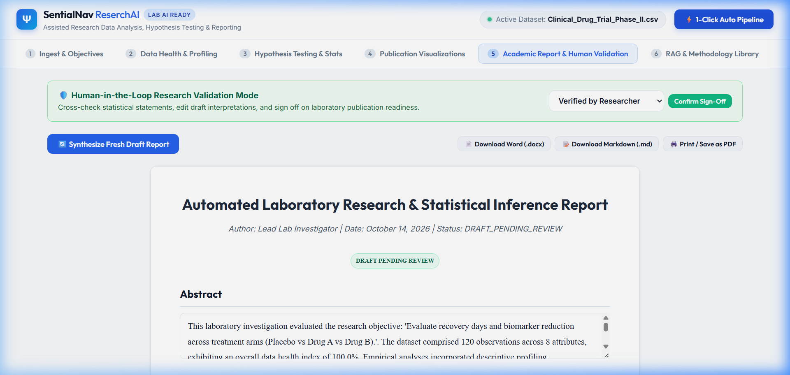
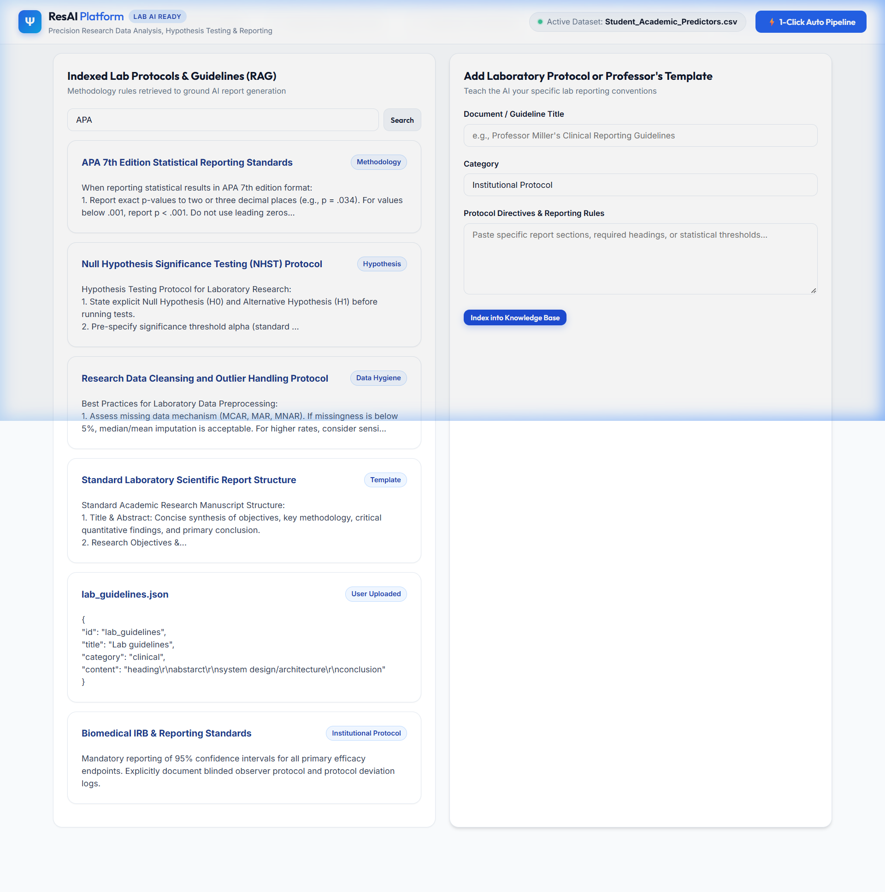

# ResAI: AI-Assisted Research Data Analysis & Reporting Platform

An enterprise-grade, precision laboratory research automation platform designed to assist researchers across quantitative and qualitative workflows. Built with **FastAPI**, **Pandas**, **NumPy**, **SciPy**, **Statsmodels**, **Plotly**, **python-docx**, and a **Retrieval-Augmented Generation (RAG)** knowledge retrieval module.

---

## 🌟 The Core Problem Solved

In typical academic, clinical, and industrial research laboratories:
1. Researchers collect requirements, experimental objectives, and datasets from laboratory instruments or trial cohorts.
2. They manually analyze data (descriptive statistics, hypothesis testing, correlation matrices, regressions).
3. They generate publication charts (box plots, histograms, heatmaps, bar graphs, and pie distributions).
4. Looking at the numerical outputs and charts, they spend hours writing academic papers and lab reports following specific institutional guidelines or professor templates.

**Our Goal:**
Automate the data quality profiling, rigorous mathematical calculations, and manuscript drafting while maintaining a **human-in-the-loop validation mechanism** to review, cross-check, and sign off on reports before publication.

> **Critical Design Principle:** Mathematical statistics are computed deterministically using trusted scientific engines (**SciPy**, **Statsmodels**, **NumPy**), eliminating LLM numerical hallucinations. The AI provides heuristic recommendation, narrative synthesis, and formatting according to **APA 7th Edition** standards.

---

## 📸 Platform Walkthrough & Screenshots

### 1. Ingestion & Natural Language Dataset Q&A (Tab 1)
Upload arbitrary laboratory datasets (`.csv`, `.xlsx`, `.xls`) or load pre-configured real-world scenarios. Interactively ask questions directly grounded in the active dataset (e.g., summary statistics, group comparisons, outliers, or distributions) with strict limited-knowledge guardrails for off-domain queries. Includes 1-click **⚡ Generate Automatic Report** buttons.


### 2. Data Health & Automated Profiling (Tab 2)
Instant data hygiene audit measuring missingness, duplicate rows, constant columns, skewness, and IQR outlier boundaries. Features 1-click automated cleaning and median/mode imputation.


### 3. Hypothesis Testing & APA Calculations (Tab 3)
Autonomous statistical mapping recommending appropriate parametric and non-parametric tests. Computes two-sample comparisons, One-Way ANOVA, Tukey HSD post-hoc contrasts, regressions, and correlation matrices with exact APA 7th Edition syntax.


### 4. Publication-Grade Interactive Visualizations (Tab 4)
Interactive Plotly charts designed for scientific publications: research bar charts with standard error (SEM) error bars, pie/donut charts for demographic shares, bivariate correlation heatmaps, box/violin distributions with jitter, and scatter plots with OLS regression bands.


### 5. Academic Report & Human-in-the-Loop Validation (Tab 5)
Synthesizes a complete 6-section peer-review-grade research manuscript. Allows researchers to edit findings inline, record validation notes, update sign-off status, and export to Microsoft Word (`.docx`) and Markdown (`.md`).


### 6. RAG & Methodology Library (Tab 6)
Deterministic knowledge retrieval module indexing scientific reporting standards, hypothesis testing guidelines, and laboratory protocols. Empowers researchers and professors to upload custom guidelines and rubrics that ground AI manuscript synthesis in verified academic rules.


---

## 🔬 In-Depth Feature Breakdown

### 1. Ingestion & Grounded Dataset Q&A Tool
- **Multi-Format Ingestion**: Supports `.csv`, `.xlsx`, and `.xls` laboratory datasets.
- **Natural Language Dataset Q&A Engine**: Ask ad-hoc questions grounded in the uploaded dataset (distributions, group contrasts, descriptive statistics, outlier audits). Returns zero-hallucination factual responses, and strictly triggers *"Knowledge is limited regarding this inquiry based on the active dataset and methodology library"* if questions fall outside the dataset scope.
- **Dynamic Research Objective Synthesis**: Automatically derives publication-grade research objectives and manuscript titles tailored specifically to the uploaded file's variables and distributions.
- **⚡ 1-Click Automatic Report Generation**: Instantly runs data hygiene checks, executes inferential hypothesis tests, and drafts a fully grounded academic manuscript.

### 2. Automated Data Quality Assessment & Profiling
- **Data Health Score (0-100%)**: Quantitative index penalizing missing cells, duplicate records, zero-variance columns, and extreme skewness.
- **Variable-by-Variable Audit**: Data type detection, cardinality, missingness rate, mean, median, IQR, and standard deviation.
- **Outlier Boundary Detection**: Computes lower and upper Tukey IQR outlier thresholds ($Q_1 - 1.5 \times \text{IQR}$, $Q_3 + 1.5 \times \text{IQR}$).
- **1-Click Auto Impute & Clean**: Replaces numerical NaNs with column medians, categorical NaNs with mode, and drops redundant rows.

### 3. Exact Mathematical Hypothesis Testing (Zero Hallucination)
All numerical statistics are calculated through deterministic algorithms in SciPy and Statsmodels:
- **Two-Sample Comparison**:
  - Student's t-test (equal variance assumed)
  - Welch's t-test (unequal variances via Levene's test)
  - Mann-Whitney U test (non-parametric rank-sum test for skewed data)
  - Cohen's $d$ effect size interpretation (Small $\ge 0.2$, Medium $\ge 0.5$, Large $\ge 0.8$)
- **One-Way Analysis of Variance (ANOVA)**:
  - Omnibus $F$-test with degrees of freedom $F(df_{\text{between}}, df_{\text{within}})$
  - Eta-squared ($\eta^2$) effect size
  - Kruskal-Wallis $H$-test non-parametric alternative
  - Post-Hoc Tukey Honestly Significant Difference (HSD) pairwise contrasts with 95% confidence intervals
- **Multiple Linear Regression (OLS)**:
  - Coefficient estimates, standard errors, $t$-values, $p$-values, and 95% confidence intervals
  - Model $R^2$, Adjusted $R^2$, $F$-statistic, AIC, and BIC
- **Bivariate Correlation Analysis**:
  - Pearson $r$ parametric correlation matrix with exact $p$-values
  - Spearman $\rho$ rank correlation matrix
- **Chi-Square Test of Independence**:
  - Pearson's $\chi^2$ statistic, degrees of freedom, and Cramér's $V$ effect magnitude
- **Strict APA 7th Edition Output**: Generates verifiable statistical statements:
  $$F(2, 117) = 137.54, p < .001, \eta^2 = 0.70$$
  $$t(118) = 4.21, p < .001, d = 0.85$$

### 4. Publication-Grade Visualizations
- **Bar Charts with Means & SEM Error Bars**: Renders empirical group means with $\pm 1 \text{ SEM}$ (Standard Error of the Mean) bars, or frequency counts grouped by sub-factors.
- **Pie & Donut Charts**: Renders demographic composition and categorical proportional shares with percentage callouts.
- **Bivariate Correlation Heatmaps**: Interactive matrix with Pearson/Spearman coefficients, annotated numbers, and diverging color gradients.
- **Box & Violin Plots**: Shows distribution shape, median, interquartile range, and jittered individual observation points.
- **Scatter Plots with OLS Regression Lines**: Bivariate scatter plots overlaid with ordinary least squares fit lines and shaded 95% confidence intervals.
- **Distribution Histograms with KDE**: Empirical density curves with outlier box margins.
- **Longitudinal Trendlines**: Tracks experimental trajectories across ordered conditions or time points.

### 5. Academic Report & Human-in-the-Loop Validation
- **Structured 6-Section Academic Manuscript**:
  1. Title, Metadata & Executive Abstract
  2. Introduction & Research Objectives
  3. Methodology & Data Preprocessing Hygiene
  4. Statistical Analysis & Hypothesis Testing (with APA tables and narratives)
  5. Scientific Discussion & Contextual Interpretation
  6. Limitations, Validity Threats & Future Work
- **Human-in-the-Loop Review**:
  - Inline editing of Abstract, Discussion, and Conclusions.
  - Recording qualitative lab notebook notes and experimental conditions.
  - Verification state lifecycle:
    - `DRAFT_PENDING_REVIEW`
    - `VERIFIED_BY_RESEARCHER`
    - `APPROVED_FOR_PUBLICATION`
- **Multi-Format Export**:
  - Formatted Microsoft Word document (`.docx`)
  - Markdown document (`.md`)
  - Standalone HTML document (`.html`)
  - Print-to-PDF via browser print stylesheet (`@media print`)

### 6. Retrieval-Augmented Generation (RAG) & Methodology Library (Tab 6)

#### 🌟 Importance & Scientific Rationale of the RAG Tab
The **RAG & Methodology Library (Tab 6)** solves the fundamental vulnerability of applying AI to scientific research: **methodological drift and procedural hallucination**.

In academic, industrial, and clinical laboratory environments, statistical numbers alone do not make a scientific paper. The interpretation, hypothesis framing, and reporting syntax must strictly follow established regulatory and departmental protocols. Standard generative models frequently fabricate citation conventions, report improper $p$-value precision (e.g., $p = 0.000$ instead of $p < .001$), omit degrees of freedom, neglect required effect sizes ($\text{Cohen's } d, \eta^2, \text{Cramér's } V$), or fail to respect lab-specific guidelines (such as institutional review board [IRB] standards or a professor's grading rubric).

**Tab 6 addresses this by providing a deterministic, verifiable knowledge grounding layer:**
1. **Zero-Hallucination Academic Standards**: Rather than allowing an unconstrained language model to guess how an ANOVA or Welch's t-test should be reported, the RAG engine retrieves exact rules from the indexed methodology store and injects them directly into the report compilation context.
2. **Professor & Lab-Specific Customization**: Every university professor, principal investigator (PI), or journal editor enforces bespoke manuscript structures or grading criteria. Tab 6 enables researchers to upload and index custom lab protocols or syllabus templates (`.txt`, `.md`, `.json`) with zero code modifications. The AI immediately conforms to these specific requirements.
3. **Automated Context Retrieval During Report Synthesis**: When the user triggers the automated pipeline or draft report generation in Tab 5, the system programmatically executes `rag_engine.retrieve_relevant_context(objective + " APA reporting")`. The top-matching methodology chunks are dynamically bound to the report context and cited under `rag_references`.
4. **Verifiable Audit Trail & Provenance**: Every generated manuscript catalogs exactly which methodology guidelines were referenced to construct the text, providing peer reviewers and laboratory directors with a transparent audit trail.

#### 📚 Built-in Core Knowledge Base Seeds
- **APA 7th Edition Statistical Reporting Standards**: Rules for exact $p$-value decimal precision, omission of leading zeros, mandatory effect sizes ($\text{Cohen's } d, \eta^2, \text{Cramér's } V$), and formatted $t(df) = t, p = p$ statements.
- **Null Hypothesis Significance Testing (NHST) Protocol**: Protocols for pre-specifying $\alpha = 0.05$, framing directional $H_0$ vs $H_1$, and distinguishing statistical significance from clinical/practical magnitude.
- **Research Data Cleansing & Outlier Handling Protocol**: Rules governing MCAR/MAR/MNAR missingness, Tukey $1.5 \times \text{IQR}$ fences, $z$-score cutoff thresholds ($|z| > 3.0$), and non-parametric test fallbacks.
- **Standard Scientific Manuscript Structure**: Canonical structure covering Title, Abstract, Introduction, Data Hygiene Methodology, Statistical Results, Discussion, and Validity Limitations.

#### ⚙️ Technical Architecture
- **Vector Space & Similarity**: Scikit-Learn `TfidfVectorizer` (with English stop-word filtering) coupled with `cosine_similarity` ranking for fast, offline, and deterministic document retrieval.
- **Persistence Store**: Custom uploaded protocols are automatically validated, sanitized, and persisted as structured JSON in `data/methodology/`, persisting across sessions and server restarts.
- **Live Search & Inspection**: Interactive search interface (`GET /api/rag/query?q=...`) allows instant inspection of similarity scores and retrieved guideline snippets.
- **Upload API Endpoint**: `POST /api/rag/upload-guideline` dynamically accepts title, category, and protocol text, persisting to disk and triggering immediate re-indexing of the vector matrix.

---

## 🛠️ Technology Stack

| Layer | Technology |
|---|---|
| **Backend Framework** | Python 3.13, FastAPI, Uvicorn |
| **Statistical Computation** | SciPy, Statsmodels, Pandas, NumPy, Scikit-learn |
| **Visualizations** | Plotly.js, Seaborn, Matplotlib |
| **Document Generation** | python-docx, Jinja2, HTML5 Print-to-PDF |
| **RAG Knowledge Base** | TF-IDF Vectorizer, Cosine Similarity, JSON storage |
| **Frontend Architecture** | Vanilla JS, Modern CSS (Glassmorphism, Inter & Outfit fonts) |

---

## ⚡ Quick Start

### 1. Launch the Application
In PowerShell or command prompt:
```powershell
python main.py
```
Or directly with uvicorn:
```powershell
uvicorn app.main:app --reload --host 127.0.0.1 --port 8000
```

### 2. Access the Platform
Open your browser and navigate to:
```
http://127.0.0.1:8000
```

### 3. Run Automated Tests
Execute the comprehensive integration test suite:
```powershell
python -m pytest tests/test_pipeline.py -v
```

---

## 📡 API Endpoints Reference

| Method | Endpoint | Description |
|---|---|---|
| `GET` | `/api/health` | Health check & platform status |
| `POST` | `/api/eda/load-sample` | Load pre-configured sample (`clinical`, `academic`, `materials`) |
| `POST` | `/api/eda/upload` | Upload user dataset (`.csv`, `.xlsx`, `.xls`) |
| `POST` | `/api/eda/clean` | 1-Click auto-cleaning & imputation |
| `GET` | `/api/analysis/recommendations` | AI-recommended statistical procedures |
| `POST` | `/api/analysis/run-test` | Unified hypothesis test execution (ANOVA, t-test, Chi-Square, OLS) |
| `POST` | `/api/analysis/visualize` | Unified Plotly chart generation (bar, pie, heatmap, scatter, box) |
| `GET` | `/api/analysis/visualize/{chart_type}` | GET visualizer by chart type |
| `POST` | `/api/report/auto-pipeline` | End-to-end automated research analysis & report drafting |
| `POST` | `/api/report/generate` | Synthesize academic draft report |
| `POST` | `/api/report/validate` | Human-in-the-loop researcher sign-off & revisions |
| `GET` | `/api/report/export-docx` | Export report as Microsoft Word (`.docx`) |
| `GET` | `/api/report/export-markdown` | Export report as Markdown (`.md`) |
| `GET` | `/api/rag/documents` | List indexed lab guidelines & methodology documents |
| `GET` | `/api/rag/query` | Retrieve methodology context for specific queries |
